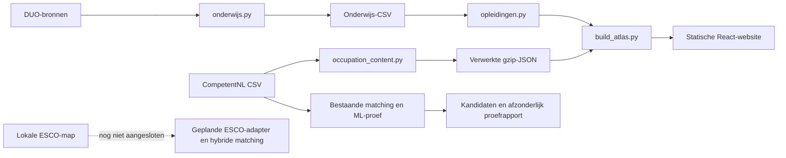

# Analyse en verbeterplan: CompetentNL → ESCO → ISCO-08

Actuele aanvulling: de ESCO-bronadapter voor ontbrekende beroepsinhoud is inmiddels toegevoegd; zie het laatste onderdeel. De onderstaande architectuuranalyse beschrijft de situatie vóór die aanvulling.

Analyse uitgevoerd op 6 november 2026. Dit is fase 1–3 van de opdracht:
bestaande architectuur onderzoeken, sterke punten en beperkingen vaststellen,
en een concreet implementatieplan maken. De bestaande matching, resultaten,
website en ruwe bronbestanden zijn in deze fase niet vervangen of verplaatst.

## 1. Architectuur van de huidige toepassing

| Onderdeel | Bestaande implementatie |
|---|---|
| Onderzoek en verwerking | Python; CSV, gzip-JSON en lokale caches |
| Website | React 19, TypeScript, Vite 6, Recharts |
| Studentenimport | `research/onderwijs/onderwijs.py` |
| Onderwijsadapter | `research/pipeline/imports/onderwijs.py` |
| CompetentNL-beroepsinhoud | `research/pipeline/imports/occupation_content.py` |
| Opleidingstab | `research/pipeline/imports/opleidingen.py`, `website/src/components/Education.tsx` |
| Huidige matching | `research/pipeline/imports/opleiding_beroep.py` |
| Bestaande ML-proef | `research/pipeline/imports/opleiding_beroep_ml.py` |
| Website-export | `research/pipeline/imports/build_atlas.py` en `website/scripts/export_research.py` |
| Publicatie | Bestaande publicatiemanifesten, statische JSON/CSV en GitHub Pages |
| Tests | Python unittest en Node-tests; vóór deze audit 45 Python-tests geslaagd |

Er is geen applicatiedatabase, ORM-configuratie of databasebestand aangetroffen
in de onderzochte projectcode/checkout. De huidige toepassing is bestandsgedreven;
zij vraagt geen live database op voor matching of websiteweergave. Een eventuele
externe database kan niet uit deze code worden afgeleid. Een nieuwe database
introduceren is voor deze omvang niet nodig.



De bestaande koppeltabel en de ML-proef worden niet automatisch als bevestigde
beroepsroutes aan de website toegevoegd. Die scheiding blijft behouden.

## 2. Wat al werkt en behouden moet blijven

- Bronbestanden blijven intact; codes en voorloopnullen worden als tekst verwerkt.
- Specifieke CompetentNL-beroepen behouden hun URI, taken, vaardigheden,
  kennisgebieden en bestaande ISCO-code. De websitegroepering op ISCO mag niet
  de specifieke beroepsprofielen voor matching vervangen.
- CBS-naamrelaties, CREBO-context en geclassificeerde beroepsniveaus zijn
  beschikbaar; zij blijven herleidbare bronnen en aanvullende signalen.
- De lexicale matcher gebruikt TF-IDF/cosinus, naamvarianten en IDF-gewogen
  kenmerkenoverlap. Er is geen afzonderlijke fuzzy-matchingbibliotheek nodig.
- De ML-proef heeft batchverwerking, gepinde MiniLM-modelrevisies, lokale
  embeddingcache, bronhashes en versiegebonden bronbeoordelingen.
- De ML-proef staat naast de referentietabel en wijzigt die niet.
- De 75 extra onzekere opleidingen en zes aanvullende controles zijn al
  onderzocht. Op elf broncontroles haalde semantisch zoeken 7/11 op plaats 1
  en 11/11 in de top drie. De gebruikte cross-encoder haalde slechts 6/11 op
  plaats 1, tegenover 8/11 voor de oude methode. Geen onafhankelijke benchmark.
- Zestien sessiebeoordelingen bevatten brongebonden argumenten, maar zijn
  geen menselijke gold labels of automatisch uitgevoerde LLM-API-validatie.

## 3. Werkelijke lokale ESCO-inhoud

Oorspronkelijke bronmap: `ESCO dataset - v1.2.1 - classification - nl - csv/` in de
repositoryroot. De naam noemt versie 1.2.1; de individuele CSV-hashes worden
in de audit berekend. Herkomst/release en inhoudshashes blijven afzonderlijke
metadata. De map is in deze analyse niet hernoemd of gekopieerd.

| Bestand | Ruwe rijen | Betekenis |
|---|---:|---|
| `occupations_nl.csv` | 3.043 | 3.039 unieke beroeps-URI’s |
| `skills_nl.csv` | 13.960 | 13.939 unieke competentie-URI’s, inclusief kennis |
| `occupationSkillRelations_nl.csv` | 126.051 | 67.600 essentiële en 58.451 optionele relaties |
| `ISCOGroups_nl.csv` | 619 | 10 hoofgroepen, 43 subhoofgroepen, 130 subgroepen, 436 unitgroepen |
| `broaderRelationsOccPillar_nl.csv` | 3.648 | Expliciete beroeps- en ISCO-hiërarchie |
| `broaderRelationsSkillPillar_nl.csv` | 20.819 | Competentiehiërarchie |
| `skillSkillRelations_nl.csv` | 5.818 | 189 essentiële en 5.629 optionele competentierelaties |
| `skillsHierarchy_nl.csv` | 640 | Groepshiërarchie van competenties |
| `transversalSkillsCollection_nl.csv` | 95 | Aanvullende verzameling algemene competenties |

Er zijn achttien CSV-bestanden, inclusief digitale, groene, onderzoeks- en
taalverzamelingen en een kolommenwoordenboek. ESCO-kennis is geen afzonderlijke
bronmap: `skillType=knowledge` onderscheidt kennis binnen `skills_nl.csv`.

### Gecontroleerde datakwaliteit

- Vier beroeps-URI’s en 21 competentie-URI’s komen dubbel voor. De verschillen
  beperken zich tot `modifiedDate`. Ontdubbelen gebeurt straks op URI met
  behoud van bron- en datummetadata, vóór joins, IDF en embeddings. Toekomstige
  inhoudelijke conflicten moeten een controlefout geven, niet stil overschrijven.
- Unieke competenties: 10.715 `skill/competence`, 3.219 `knowledge` en vijf zonder
  ingevuld type. De vijf blijven als ongeclassificeerd bewaard; 59
  beroep–competentierelaties hebben eveneens geen ingevuld type.
- `reuseLevel` is beschikbaar: 3.044 beroepsspecifiek, 6.655 sectorspecifiek,
  3.783 sectoroverstijgend, 452 transversal en vijf onbekend. De verzameling
  van 95 transversal skills is niet identiek aan deze taxonomische verdeling.
- Alle beroeps- en competentieverwijzingen in de 126.051 relaties zijn lokaal
  aanwezig. Geen dubbele beroep–competentie–relatietypecombinaties gevonden.
- Alle unieke ESCO-beroepen hebben een viercijferige `iscoGroup`. De expliciete
  hiërarchie bereikt steeds dezelfde unitgroep; geen verschillen of cycli
  gevonden bij deze beroepscontrole.
- `definition` is leeg bij alle ESCO-beroepen en competenties. `description`
  is daar wel gevuld. De import moet dit werkelijke schema gebruiken.
- `ISCOGroups_nl.csv` heeft namen en hiërarchie, maar lokaal **geen gevulde
  groepsbeschrijvingen**. Geen beschrijvingen verzinnen of beroepsdefinities
  stilzwijgend als officiële groepsbeschrijving presenteren.
- In 188 hiërarchierijen ontbreken niet-toepasselijke laatste velden: vier
  rijen hebben 11 velden, 28 hebben 12 en 156 hebben 13, tegenover 14 kopvelden.
  Alleen deze ontbrekende eindvelden mogen in de adapter leeg worden weergegeven;
  geen ontbrekende hiërarchieniveaus invullen. Extra velden blijven een fout.
- `regulatedProfessionNote` is gevuld als URI: hoofdzakelijk `unregulated`,
  daarnaast `regulated`. Een gevuld veld betekent dus niet automatisch gereguleerd.
- `naceCode` bevat NACE 2.1-URI’s, soms meerdere in één cel. Dat is nieuwe
  sectorcontext in ESCO; de huidige matcher gebruikt NACE niet. NACE is geen
  beroepenindeling en wordt geen harde één-op-éénfilter op opleidingen.

## 4. CompetentNL en ontbrekende bruggen

`mbo.csv` bevat 18.872 regels voor 438 opleidingscodes. Herhaalde rijen bundelen
relaties; zij zijn geen extra opleidingen. Bruikbaar zijn `code`, `opleiding`,
`naam`, `definitie`, `beschrijving`, `nlqf_niveau`, vereistevlaggen en
`hat_essentieel`/`hat_belangrijk`. Een cohort-/geldigheidsdatum ontbreekt.

Er zijn 634 unieke opleidingskenmerkverwijzingen. Daarvan zijn 387 te benoemen
via de aanwezige CompetentNL-beroepskenmerken: 126 vaardigheden en 261
kennisgebieden. De overige 247 zijn onopgeloste genid-verwijzingen.

**Niet aangetroffen in de huidige bronset:**

1. Een expliciete CompetentNL-beroep → ESCO-beroep-crosswalk.
2. Een expliciete CompetentNL-competentie → ESCO-competentie-crosswalk.
3. Afzonderlijke taakrelaties per mbo-opleiding.
4. Volledige aanvullende eisen voor rechtstreekse toegang tot een beroep.
5. Een onafhankelijk gevalideerde, meervoudige MBO → ESCO-referentiedataset.

De audit vindt geen directe ESCO-beroep- of competentie-URI-overlap in de
onderzochte CompetentNL-velden, ook niet na controle op http/https en afsluitende
slash. Dit bewijst niet dat een crosswalk buiten deze lokale bronset niet
bestaat. De ESCO-hiërarchieën en competentierelaties zijn interne ESCO-relaties,
geen vervanging voor een ontbrekende crosswalk.

Een gedeelde ISCO-groep, overeenkomstige naam of semantisch overeenkomstige
competentie is een kandidaatbrug, geen officiële gelijkstelling. Bestaande
CompetentNL-beroep → ISCO-relaties blijven wel officiële classificatie-invoer.

De aanwezige `beroepen_taken.csv` beschrijft **beroepen**, niet opleidingen.
Taken van een voorspeld beroep terugkopiëren naar de opleiding zou cirkelbewijs
opleveren. Voor ontbrekende opleidingstaken blijft de component standaard
onbekend. Een later uit beschrijving afgeleid taakprofiel moet als afgeleid
worden gemarkeerd en mag geen officiële taakdekking claimen.

## 5. Gericht ontwerp binnen de bestaande structuur

### Canoniek gegevenscontract

Maak een kleine ESCO-adapter in `research/pipeline/imports/esco.py` en een
orchestrator `esco_matching.py`; hergebruik `common.py`, de bestaande tekst-
vergelijking en ML-omgeving. Een aparte competentiemodule en evaluator zijn
alleen nodig voor hergebruik en testbaarheid. Geen nieuw applicatieproject.

Het canonieke profiel scheidt `names`, `description`, `tasks`, `skills`,
`knowledge` en `requirements`. Ieder element heeft een URI, bron, taal,
bronversie, belang en beschikbaarheidsstatus. Ontbrekend is niet hetzelfde
als een lege maar volledig bekende competentieset. Registreer `official`,
`derived` of `predicted` per relatie; niet één officiële vlag voor de hele keten.

Relaties en hun betekenis:

- MBO-code → opleidingsprofiel: bronidentificatie.
- ESCO-beroep → essentiële/optionele competentie: officiële bronrelatie.
- ESCO-beroep → viercijferige ISCO: officiële bronrelatie.
- CompetentNL-kenmerk → ESCO-kenmerk: alleen officieel met een echte crosswalk;
  anders een voorspelde, afzonderlijk beoordeelbare brug.
- MBO → ESCO-beroep: voorspelde opleidingsroute tenzij apart gevalideerd.

De huidige CLI blijft werken. Voeg een expliciete ESCO-modus/configuratie toe;
het huidige CompetentNL-doel en de huidige uitvoer blijven de standaard totdat
de nieuwe modus voldoende is gecontroleerd.

### A. Officiële relaties vóór modelinvoer

Importeer URI’s, labels, alternatieve labels, bronversies, ISCO en essential/
optional-relaties. Controleer sleutels, referenties, meervoudige labels,
ontdubbeling en hiërarchie. Gebruik `iscoGroup`, controleer die met de expliciete
hiërarchie en leid de code niet af door een ESCO-`code` af te kappen.

Het ESCO-veld `code`, bijvoorbeeld `2654.1.7`, is niet hetzelfde als de
viercijferige `iscoGroup`. Nederlandse voorbeelden en bestaande ISCO-relaties
blijven ondersteunende input, zonder onbekende MBO–ESCO-relaties officieel te maken.

### B. Afzonderlijke meertalige representaties

Voorkeur: `BAAI/bge-m3` via de reeds beschikbare Sentence Transformers-interface,
eerst alleen dense embeddings. Alternatief: `intfloat/multilingual-e5-large`,
met de juiste query-/passageprefixen. Pin model-ID, revisie en verwerking.
BGE-M3 kan meer representatievormen leveren, maar sparse/multivector-inferentie
wordt niet verondersteld bij een gewone dense SentenceTransformer-aanroep.
Geen extra FlagEmbedding-dependency zolang die functies niet worden gebruikt.

Bereken vectors afzonderlijk voor namen, beschrijvingen, individuele taken,
vaardigheden en kennisgebieden. Veldvectoren zijn een aanvulling op individuele
competentievectoren, geen vervanging van vereistedekking. Chunk lange teksten
met vastgelegde tokenisatie, maximale lengte en pooling; bronpassages behouden.

Cache op object-URI, veld, inhoudshash, bronversie, modelrevisie, taal,
preprocessingversie en query-/passagerol. Batchverwerking blijft configureerbaar.
Bewaar modellen en vectors in een configureerbare lokale, genegeerde cache;
de huidige MiniLM-cache wordt niet als BGE/E5-cache hergebruikt.

Voor 438 × 3.039 beroepsvergelijkingen is een dense float32-scorematrix ongeveer
5,3 MB. NumPy en lokale indexen volstaan voor de eerste uitvoering. FAISS of een
nieuwe database zijn pas nodig als een meting hun nut aantoont.

### C. Bidirectionele competentiedekking

Maak bij beschikbare informatie een matrix tussen individuele
opleidingscompetenties en beroepsvereisten. Een geverifieerde identifierrelatie
is apart herkenbaar; semantische overeenkomsten blijven modelbewijs.

Bereken per soort ten minste:

- **Opleiding → beroep:** welk deel van de bekende opleidingsinhoud heeft
  aantoonbare of semantische aansluiting bij dit beroep?
- **Beroep → opleiding:** welk deel van de essentiële beroepsvereisten wordt
  door de beschikbare opleidingsinhoud ondersteund?
- Ondersteunde en niet-aangetoonde essentiële vereisten, optionele ondersteuning,
  bronbeschikbaarheid en eventueel conflicterende eisen.

Gebruik bijvoorbeeld per vereiste de beste ondersteuning uit het andere
profiel en een gewogen gemiddelde met inverse beroepsfrequentie. Bewaar beide
richtingen; een gemiddelde van alle teksten is daarvoor onvoldoende. Test ook
of dezelfde algemene opleidingsvaardigheid te veel verschillende specifieke
vereisten schijnbaar afdekt. Dubbeltellingen en automatisch doorrollen van
alle bovenliggende of verwante competenties zijn niet toegestaan.

`reuseLevel` en frequentie per uniek beroep begrenzen de bijdrage van algemene
vaardigheden. Unknown types blijven zichtbaar. Het ontbreken van bewijs heet
**niet aangetoond in deze bron**, niet ‘de student beheerst dit niet’.
Als opleidingstaken ontbreken, is taakdekking `null`, geen nul en geen kopie
van de taken van de voorspelde kandidaat.

### D. Configureerbare combinatie en klassen

Experimentele beginwaarden: taken 0,35, vaardigheden 0,25, beschrijving 0,20,
kennis 0,15, naam 0,05. Leg een versie van de configuratie vast.

`score = som(w_i × s_i voor beschikbare componenten) / som(w_i beschikbaar)`.
Bewaar daarnaast alle originele gewichten, actieve gewichten, deelscores,
ontbrekende componenten en het beschikbare aandeel van het scoremodel.
Zo wordt ontbrekende informatie niet als mismatch behandeld, maar evenmin
als voldoende dekking verstopt. Een volledige taakcomponent ontbreekt nu
standaard: 35% van de bedoelde bewijssoorten is dan niet rechtstreeks beschikbaar.

Gebruik `direct`, `verwant`, `onzeker` en `geen match` als inhoudelijke klassen,
los van de validatiestatus. Drempels zijn model-/configuratiegebonden en
experimenteel totdat ze op beoordeelde voorbeelden zijn bepaald. Standaard
geen automatische goedkeuring; ontbrekende data zijn geen bewijs van ‘geen match’.
Bestaande verplicht ingevulde voorstellen blijven herkenbaar in de oude modus;
de nieuwe ESCO-modus mag onderbouwd afzien van een toewijzing.

### E. Reranking als afzonderlijk experiment

Haal 20–30 ESCO-kandidaten op. Leg embeddings-only, competentiescore en
reranking apart vast. Gebruik de bestaande cross-encoder als vergelijkingsbasis,
niet als bewezen verbetering. Vergelijk op dezelfde kandidaten en dezelfde
labels; rapporteer wijzigingen in bereik en rangorde afzonderlijk.

### F. Optionele LLM-beoordeling

Werk provider-onafhankelijk, met een gevalideerd JSON-resultaat en een
schakelaar die standaard geen externe LLM-aanroep uitvoert. Zonder LLM blijven
matching en evaluatie volledig werken. Alleen bronkandidaten met bestaande URI’s
en codes selecteren; ook afwijzen, meerdere routes kiezen en een kandidaatset
uitbreiden moeten mogelijk blijven.

Vereiste velden: argumenten per kerntaak/competentie, tegenbewijs,
verantwoordelijkheidsniveau, geciteerde bron-URI/veld/passages, aanvullende
scholing/certificering en een expliciete `unknown`-optie. `regulatedProfessionNote`
is een aanwijzing om eisen te controleren, geen volledige juridische beoordeling.
Een LLM mag geen formele toegangseis of kanspercentage uit algemene kennis
verzinnen. Een assistentbeoordeling is niet automatisch een menselijke validatie.

### G. Meerdere ESCO-beroepen naar ISCO

Bewaar alle relevante ESCO-beroepen en groepeer op hun officiële `iscoGroup`.
Dedupliceer eerst op ESCO-URI. Begin met de maximale ondersteunde beroepsscore
per ISCO, niet met een som. Behoud alle onderliggende beroepen, deelscores en
argumenten; meerdere zwakke beroepen verhogen de groepsscore dan niet vanzelf.

Max-pooling voorkomt geen enkele statistische groottebias: grotere groepen
hebben meer kansen op een hoge uitschieter. Evalueer dit expliciet. Ga pas bij
voldoende labels over op complexere kalibratie. Een ISCO-resultaat is geen
nieuwe studententelling en de groep blijft viercijferig.

## 6. Uitvoer- en opslagcontract

Een technisch matchrecord bewaart ten minste:

- MBO-code/URI/naam, bron- en contextversie;
- ESCO-URI/naam en de officiële ISCO-code/naam;
- componenten en beide dekkingsrichtingen, gewichten en bronbeschikbaarheid;
- ondersteunde taken/vaardigheden/kennis, per element het bewijs, en niet-
  aangetoonde essentiële vereisten;
- eisen-/niveaucontrole, inclusief onbekende informatie;
- methode A–E, modellen/revisies, configuratie- en run-ID, bronhashes;
- inhoudelijke matchklasse, validatiestatus, reviewer/agent en motivering.

Bewaar officiële en voorspelde relaties per stap. Een officieel ESCO–ISCO-pad
maakt de eerste voorspelde MBO–ESCO-stap niet officieel. Maak een kleine leesbare
CSV naast gzip-JSON met het bewijs; geen onnodige volledige matrixexports.
Gebruik een nieuw, expliciet ESCO-artefact en vervang de bestaande tabellen niet
stilzwijgend. De website wordt pas later via de bestaande exportlaag aangesloten.

## 7. Evaluatiecontract

A–E moeten hetzelfde doeluniversum van ESCO-URI’s gebruiken. De oude
CompetentNL-kandidaten kunnen niet als ESCO-labels worden behandeld.

| Model | Nieuwe vergelijking |
|---|---|
| A | Namen/labels en lexicale tekstsimilarity op ESCO |
| B | Meertalige embeddings, zonder competentiedekking |
| C | B plus afzonderlijke taken-, vaardigheden- en kennisdekking |
| D | C met optionele reranking |
| E | D met afzonderlijk vastgelegde LLM-beoordeling |

Gebruik meerdere positieve ESCO-labels per opleiding. De huidige elf
ISCO-controles en zestien sessiebeoordelingen zijn hiervoor onvoldoende.
Leg vast welke kandidaten positief, negatief of nog onbeoordeeld zijn en of
de referentielijst voor een opleiding volledig is. Onbeoordeeld is niet negatief.

Bereken precision, recall en F1 voor de uiteindelijke meervoudige toewijzing,
Recall@10 voor retrieval en Precision@k voor kandidaten. Doe dit zowel op
ESCO- als op geaggregeerd ISCO-niveau. Rapporteer macro/micro, dekking en
onthoudingen. Waar de referentie onvolledig is: geen algemene recall/F1-claim;
rapporteer alleen de beoordeelde subset met haar dekking of expliciete grenzen.

Splits per mbo-niveau, CREBO-sector/subgroep en ISCO-groep. Vermeld aantallen
per stratum; kleine strata onderbouwen geen algemene prestatieclaims.
Houd verwante opleidingsversies bij elkaar bij train/validatie/test. Selecteer
gewichten/drempels uitsluitend op training/validatie; een aparte testset blijft
buiten modelkeuze. Gebruik voorspellingen niet als eigen gold labels.

LightGBM is pas een volgende stap bij voldoende extern gevalideerde voorbeelden
met positieve én negatieve paren. Bewaar dan de deelscores/dekking als features,
gebruik gescheiden splits en kalibreer kansen afzonderlijk. Nu geen nieuwe
supervised dependency installeren.

## 8. Gefaseerde uitvoering en acceptatie

| Fase | Gerichte wijziging | Controle / oplevering |
|---|---|---|
| 1–3, nu uitgevoerd | Architectuur, broninventaris, relaties en plan | Alleen-lezen audit; huidige functionaliteit behouden |
| 4a | ESCO-adapter, ontdubbeling, genormaliseerde relationele profielen en configuratie | Geen verwijzingsverlies; 3.039 unieke beroepen; officiële ISCO-consistentie |
| 4b | BGE-M3 veldembeddings, batch/cache en competentiedekking | Ontbrekende component blijft onbekend; richtingasymmetrie en algemene kenmerken getest |
| 4c | Meervoudige ESCO-kandidaten, ISCO-aggregatie en bewijsrecords | Duplicaten/zwakke extra beroepen verhogen een groepsscore niet; bronstatus blijft per relatie |
| 5 | A–D-evaluator, gedeelde referenties en rerankingexperiment | Zelfde kandidaat-/labeluniversum; geen nauwkeurigheidsclaim zonder voldoende labels |
| 6 | Optionele gestructureerde LLM-review, later supervised learning | Geen fictieve kandidaat/bron/eis; geen ongekalibreerde kans; werkt zonder LLM |
| Later | Bestaande website-export uitbreiden | Bestaande routes/downloads behouden; nieuwe onzekere relaties herkenbaar |

De eerstvolgende implementatie bestaat dus uit een kleine adapter en
competentiemodule, niet uit een nieuwe applicatie. De ontbrekende
crosswalks blokkeren een voorspelde vergelijking niet, maar moeten zichtbaar
blijven. Voor sterkere taakdekking is een aanvullende opleidings-taakexport
nodig; voor `hat_belangrijk` een export die de genid-verwijzingen uitwerkt.

## 9. Reproduceerbare analyse en tests

Uitvoeren vanaf de repositoryroot:

```bash
python -m research.pipeline.imports.esco_audit
python -m unittest discover -s tests
```

De audit schrijft JSON naar stdout en verandert geen bron- of matchbestand.
Zij rapporteert achttien bestanden met schema, rijvorm en hash, dubbele URI’s,
relatie-integriteit, hiërarchie, onbekende types en identifieroverlap.
De hiërarchische eindvelden worden alleen in de leesrepresentatie als leeg
weergegeven. Er is geen bestand met genormaliseerde brondata weggeschreven.

De audit voegt vijf gerichte tests toe: metadata- versus inhoudelijke
URI-conflicten, behoud van viercijferige hiërarchiecodes, cycli, onvolledige
kernrijen en optionele eindvelden. Het totaal is nu 50 geslaagde Python-tests.

In de implementatiefasen volgen tests voor: vectorcache-invalidatie en
veldrollen, ontbrekende componenten/renormalisatie, beide dekkingsrichtingen,
essentiële versus algemene competenties, meerdere geldige beroepen,
ISCO-groepsgrootte/duplicaten, onbekende eisen en volledigheid van referenties.
Softwaretests zijn geen validatie van de inhoudelijke beroepsmatches.

## 10. Methodologische bronnen

- [ESCO-beroepen en officiële ISCO-structuur](https://esco.ec.europa.eu/en/classification/occupation_main).
- De lokale `dictionary_nl.csv` voor de feitelijke kolommen en relatiebetekenis.
- [BGE-M3-modelkaart](https://huggingface.co/BAAI/bge-m3): meertalige dense,
  sparse en multivector-mogelijkheden; gebruik daarvan expliciet onderscheiden.
- [Multilingual E5 large-modelkaart](https://huggingface.co/intfloat/multilingual-e5-large):
  alternatieve embeddingadapter met passende invoerprefixen.
- [Bestaande onderzoeks- en beoordelingsmethodiek](METHODIEK_OPLEIDING_BEROEP.md)
  voor de voorafgaande CompetentNL–ISCO-proef.

Geen van deze bronnen bewijst de nauwkeurigheid van een nog niet uitgevoerde
nieuwe MBO–ESCO-matching. BGE-M3 en E5 zijn in deze analysefase niet gedownload,
uitgevoerd of als beter gevalideerd gepresenteerd.

## ESCO-aanvulling voor ontbrekende beroepsinhoud

This publication uses the ESCO classification of the European Commission.

Bron: Europese Commissie, **ESCO v1.2.1, Nederlands (nl)**, lokaal aangeleverde CSV-export.
De website gebruikt de voorgeschreven toepassingsvermelding:
“This service uses the ESCO classification of the European Commission.”
Zie de [officiële ESCO-gebruiksvoorwaarden en bronvermelding](https://esco.ec.europa.eu/en/about-esco/faq?page=1).
ESCO-hergebruik valt onder Besluit 2011/833/EU; de CompetentNL-vermelding CC BY 4.0
wordt niet aan ESCO toegekend.

De adapter `research/pipeline/imports/esco.py` vult uitsluitend ISCO-groepen zonder
CompetentNL-beroepsinhoud aan: 33 extra groepen, samen 429 van de 436 groepen.
Bestaande CompetentNL-inhoud en AI-scores blijven behouden. De officiële viercijferige
ESCO–ISCO-relatie wordt gecontroleerd tegen de classificatiehiërarchie.
De Nederlandse beroepsnamen, beschrijvingen, vaardigheden en kennisgebieden zijn
broninhoud; essentieel/optioneel volgt de officiële competentierelaties.
ESCO levert in deze bestanden geen afzonderlijke takenlijst. Die wordt niet afgeleid
of verzonnen. De resterende zeven groepen (1113, 4414, 6310, 6320, 6330, 6340, 9624)
hebben in beide bronnen geen gekoppeld beroepsprofiel.

Bewerking: selectie van ontbrekende groepen, ontdubbeling van URI-records die alleen
in wijzigingsdatum verschillen en groepering van beroepen per officiële ISCO-code.
Dit zijn geen officiële ISCO-groepsdefinities en geen nieuwe MBO–beroepvoorspellingen.
De reproduceerbare cache `data/processed/esco_aanvulling.json.gz` bevat bronversie,
taal, SHA-256-bestandshashes en herkomst per beroep; hiermee werkt de build zonder
ruwe ESCO-bestanden. Verversen: `npm run data:refresh` vanuit `website/` (vereist ook
de overige ruwe projectbronnen). De bredere semantische MBO–ESCO-matching blijft een
apart verbeterplan.

## Validatie Nederlandse relevantie van de zeven resterende groepen

Gecontroleerd op 6 november 2026 in de originele CBS-codelijst uit Downloads:
`codelijsten-isco-08.xls`, tabblad `ISCO-08 voorbeeldberoepen`, kolom
`Voorbeeldberoepen_CBS`. Precies de zeven resterende codes **1113, 4414, 6310,
6320, 6330, 6340 en 9624** dragen de CBS-opmerking:
“deze unit group beschouwt het CBS als niet relevant in de Nederlandse arbeidsmarkt”.
Er zijn in dit tabblad geen andere codes met deze opmerking.

Het ontbreken van beroepsinhoud voor deze groepen moet worden onderscheiden van
een technische inleesfout. Alle overige 429 unitgroepen hebben nu beroepsinhoud
uit CompetentNL of ESCO. Dit is inhoudelijke dekking, geen validatie van alle
beroeps- of opleidingsmatches en geen uitspraak dat deze beroepen internationaal
niet voorkomen.

Deze CBS-opmerking ontbreekt in de huidige projectkopie
`data/raw/ai_exposure/codelijsten-isco-08.xls`. De bestanden zijn niet vervangen.
Bronhash, codes en Excel-rijnummers van de gecontroleerde originele codelijst
staan in `data/processed/controles/isco_cbs_relevantie_validatie.json`.

## Centrale bronstructuur na toevoeging CBS-bestand

De aangeleverde originele codelijst staat nu in
`data/raw/cbs/codelijsten-isco-08.xls`. Dit bestand onderbouwt de relevantiecontrole. De actieve reken- en matchingimports gebruiken
`data/raw/cbs/codelijsten-isco-08-nl.xls`: de bestaande Nederlandse unitgroepsnamen
blijven zo behouden. De unitgroepsnamen in het nieuw aangeleverde bestand zijn Engels.
De eerdere kopie uit ai_complementarity is ongewijzigd gearchiveerd onder `data/raw/cbs/archive/`;
de bovenstaande constatering over de ontbrekende CBS-opmerking betreft deze oude
kopieën. De validatie verwijst nu naar de centrale bron, niet meer naar Downloads.
De 18 ESCO-bronbestanden staan in `data/raw/esco/v1.2.1/nl/`.

## Uitvoeringsfase: hybride opleidingsmatching

De nieuwe bronadapter, veldembeddings, bidirectionele competentiescores,
meervoudige ESCO-kandidaten, max-aggregatie naar ISCO en A–D-evaluator staan in
`research/pipeline/imports/mbo_esco.py`. Configuratie en drempels staan apart.
De eerste run gebruikt de bestaande lokale MiniLM-vergelijkingsbasis; BGE-M3
is configureerbaar, maar nog niet uitgevoerd. LLM-validatie en supervised
learning zijn vervolgstappen. Zie [het uitvoeringsdocument](MBO_ESCO_UITVOERING.md).
De bestaande website en koppeltabellen worden niet automatisch vervangen.
